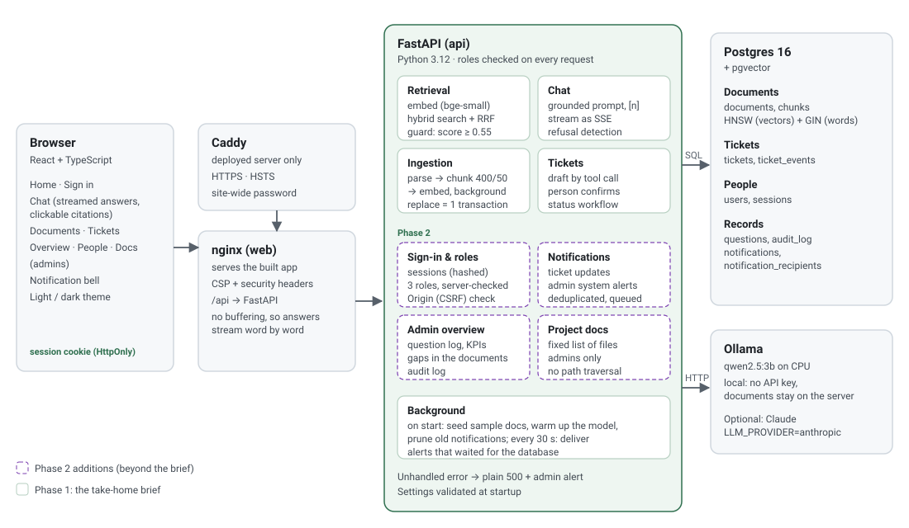

# Architecture

Ask Onboarding answers employees' questions from company documents, cites the exact passage, says "I don't know" when the documents don't cover it, and turns that into a help-desk ticket. It runs as one Docker Compose stack: React behind nginx, a FastAPI API, Postgres with pgvector, and Ollama running a local model. It needs no API key.

This page answers the brief's six questions. **[TECHNICAL.md](TECHNICAL.md)** is the complete technical reference (every module, table, endpoint and security measure), and **[GUIDE.md](GUIDE.md)** explains the features in plain language. Numbers come from [eval/run_eval.py](eval/run_eval.py) or from measurements on the development laptop (Intel Core Ultra 9 288V, 32 GB, CPU only).

| | Phase 1: the brief | Phase 2: added since |
| --- | --- | --- |
| Answers | upload, cited streamed answers, "not in the documents", ticket by tool call | typing indicator |
| Quality | 20-question eval, hybrid search | CI, 471 + 104 tests, 97% coverage, [TESTING.md](TESTING.md) |
| People | – | sign-in, three roles enforced by the server; departments and reporting lines (managers handle their team's tickets); People page |
| Operations | `docker compose up` | ticket workflow, notifications and admin alerts, admin Overview (KPIs, question log, audit), Docs page, security hardening, public deployment |

## 1. How it works today: the path of one question

1. **Browser.** The Chat page sends `POST /api/chat` with the question and up to six earlier turns, and reads the reply as a stream. The request carries an HttpOnly session cookie.
2. **nginx** forwards `/api/*` with buffering off, so words arrive as they're generated. On the public server, Caddy sits in front and adds HTTPS.
3. **Checks.** The API rejects cross-site requests (`Origin` check), looks up the session (only its SHA-256 is stored), and reads the user's role fresh from the database.
4. **Retrieval** ([search.py](backend/app/retrieval/search.py)). The question is embedded locally (`bge-small-en-v1.5`). One SQL query runs a pgvector cosine search (HNSW index) and a Postgres full-text search (GIN index), takes the top 20 of each, and merges them with **Reciprocal Rank Fusion**. The top 5 chunks are kept.
5. **Guard 1: the score.** If the best cosine similarity is below `MIN_SCORE=0.55`, the answer is "I couldn't find this in the company documents." **The model is never called.**
6. **Grounded prompt** ([prompt.py](backend/app/chat/prompt.py)). The prompt says: use only the sources, cite `[n]` after each fact, give an exact refusal sentence when the sources don't answer, and treat sources as data, not instructions. Sources are wrapped in numbered `<source>` tags, with tags inside them and filenames escaped.
7. **The model** (`qwen2.5:3b` through Ollama, or Claude with `LLM_PROVIDER=anthropic`) streams tokens, which the API forwards as Server-Sent Events.
8. **Guard 2: refusal detection.** An exact refusal, or an uncited paraphrase of one, ends with `answered: false`, and the chat offers a ticket. Otherwise the final event lists only the sources the answer cited, with file, page and character offsets. Clicking `[n]` highlights exactly that passage.
9. **Logged.** When the stream ends, however it ends, the question, outcome, sources and timing go into the question log, which the admin Overview reads.

**Uploads and deletes** (admins only; managers can browse the library, employees only open what answers cite). Uploads are stored as `processing`. Old chunks for the same filename are deleted **in the same transaction**, so replaced text is never searchable. A background task parses, chunks (400 characters, 50 overlap, never across PDF pages) and embeds the file, then writes the chunks and `ready` together.

## 2. Choices, and what didn't work

| Choice | Why | Evidence |
| --- | --- | --- |
| **400-character chunks, 50 overlap** | Characters, not tokens: no tokenizer, and the same unit the highlight uses | vs 800: accuracy 94% vs 88%, right document cited 94% vs 81%, prompt 45% smaller |
| **Hybrid search, top 5** | Keywords catch exact terms that embeddings blur ("parking") | hit@1 100% hybrid vs 94% vector-only |
| **Postgres for everything** | Vectors, full text, tickets, sessions and logs in one database: replacing a document is one transaction | – |
| **qwen2.5:3b, local** | Free, no key, documents never leave the server, supports tool calls | 15/16 correct, 4/4 refusals, 0 false refusals |
| **Sessions in Postgres, not JWTs** | Sign-out and role changes take effect immediately; nothing to revoke | tested: a demoted user loses rights mid-session |
| **Polling for notifications (30 s)** | One indexed count; works behind any proxy | median 39 ms per poll through nginx, on the laptop |

**What didn't work:**
- **The first threshold guess (0.35):** an unrelated passage scored 0.38. Calibrated to 0.55.
- **A threshold alone can't refuse near-topic questions:** "stock options?" scores like a real answer. Hence the prompt's refusal rule, detected in code.
- **Repeating the citation rule** at the end of the prompt caused wrong refusals.
- **Exact-match refusal detection** missed paraphrases. The eval caught it.
- **nginx forwarded `$host`,** dropping the port, so the new CSRF check refused every same-site request. Caught by testing through nginx.
- **The Overview counted days in UTC,** so 00:30 in Dubai landed on the previous day. Caught by looking at a screenshot. Days now follow the viewer's time zone.

## 3. Scaling to 5,000 employees, 200,000 documents and 20,000 questions per day

That's about **5–6 million chunks**, and 0.7 questions per second on average (about 1.5 at peak).

- **Answer generation breaks first.** One CPU answer takes 8–15 s, about 0.1 questions per second per box.
  - **Change:** a 7–8B model on GPUs with batching (for example vLLM, about $500–700 per GPU per month), or a hosted model. At about 1,000 input and 100 output tokens per question, Claude Haiku 5.5 costs about **$90/month** and Sonnet 5.5 about **$1,800/month**.
  - An answer cache and prompt caching cut both cost and latency.
- **Ingestion.** It runs at 31 chunks/s, so a full re-embed takes about 50 hours.
  - The nightly sync must be **incremental**: Drive's changes feed and Confluence's last-modified search, the existing hash check, and handling of deletions.
  - At about 2% churn, that's about an hour on one worker. Run it on **queue-fed workers**, outside the API.
  - **Document permissions** must be synced and filtered in the search SQL.
- **Storage.**
  - Vectors are about 9 GB, plus the same again for the index (`halfvec` halves both). That's one Postgres instance with a read replica.
  - The **original files (about 100 GB)** move to object storage.
  - The **question log** grows by about 7 million rows a year: partition it by month and keep a retention period.
- **Sign-in:** demo sign-in becomes **company SSO** (OIDC). Sessions and role checks stay as they are.
- **Notification polling:** 5,000 open tabs polling every 30 s is about 170 requests/s of an indexed count. That's fine on a replica, but **server push** (SSE, which the app already uses for answers) removes it.
- **API:** a connection pool and several replicas. Today it opens one connection per request.

## 4. Failure mode: the LLM is down for 30 minutes

Checked by stopping the Ollama container:
- **Chat shows a clear error** within about 5 s. Each question fails on its own, with no frozen spinner.
- **Admins get one alert:** "The answer model failed", with the reason. It's **one alert for the whole outage, counting the repeats**, enforced under a database lock, so simultaneous failures can't duplicate it. Opening it shows the fix steps and a live check that turns to *Recovered* when Ollama is back.
- **Everything else keeps working:** off-topic questions are still refused, and Documents, Tickets and the Overview all load.
- **Ticket drafts fall back** to the employee's own question, because an outage is when people most need a ticket.
- **If the database is down too,** alerts wait in memory and are delivered when it's back.
- **Recovery:** `restart: unless-stopped`, and the model is kept in a volume. The first answer after a restart is slow (29 s measured).
- **Next:** fall back to Claude when Ollama fails, and show the top passages without a summary.

## 5. Quality: knowing a change is better before release

- **Every pull request runs the gates in CI:**
  - lint, including security rules
  - type checks
  - 471 backend and 104 frontend tests (**negative and security tests included**, catalogued with results in [TESTING.md](TESTING.md))
  - a **95% coverage floor**
  - dependency audits
  - both Docker images
- **The eval is the release gate for answers.** 20 held-out questions are run against any prompt, model, chunk size or search mode. A change ships only if refusals don't get worse and accuracy doesn't drop. Every answer is read, not just the score.
- **Weakness:** 16 answerable questions is a small sample (one question is 6 points). Next steps:
  - grow the set to 150–200 questions from real traffic. **The Overview's "What the documents don't cover" list and the tickets are that source.**
  - run each configuration several times, and add an LLM judge with a fixed rubric
- **After release:** watch the answer rate, the gaps list, the ticket rate and the time to first word in the Overview.

## 6. RAG vs. fine-tuning

**RAG stays the core.** Policies change nightly, answers need citations, removed documents must disappear at once, and "not in the documents" must be detectable. Knowledge baked into model weights can't be cited, updated per document or removed.

**Fine-tune in addition to RAG, for behaviour, not facts:**
- **The answering model:** the remaining eval errors are behavioural (a missing `[n]`). A LoRA fine-tune on a few thousand grounded examples could make a cheap local model reliable.
- **The embedding model, on company vocabulary:** acronyms and team names, trained on question-to-passage pairs from the question log and tickets.

Either is worth doing only once the eval set is big enough to prove it helps.
