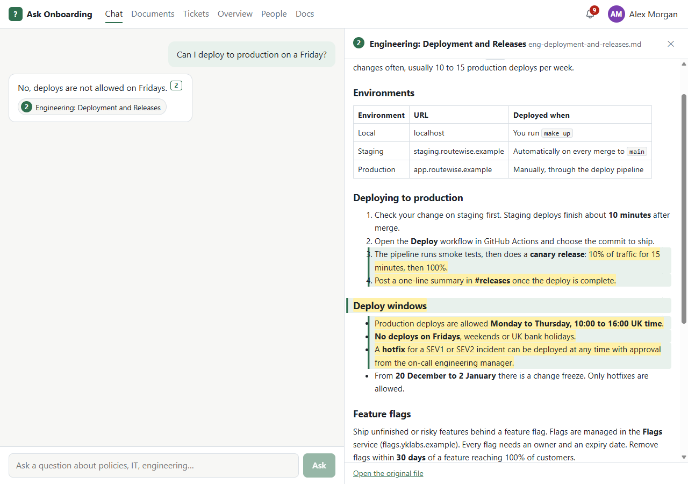
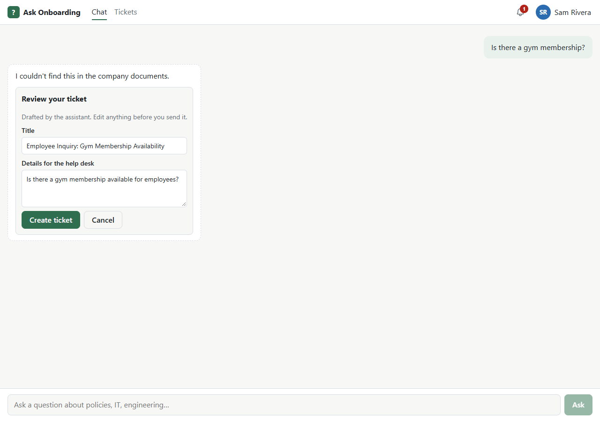
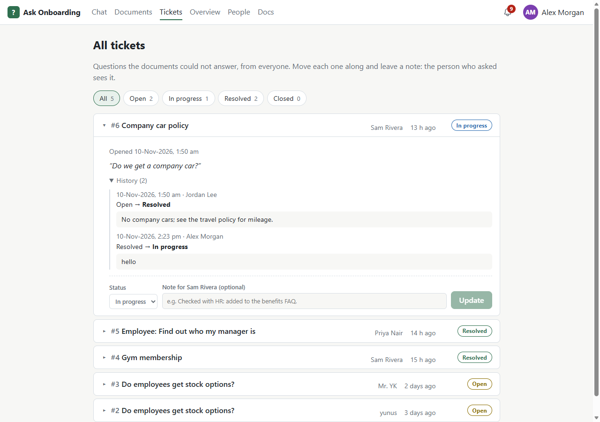
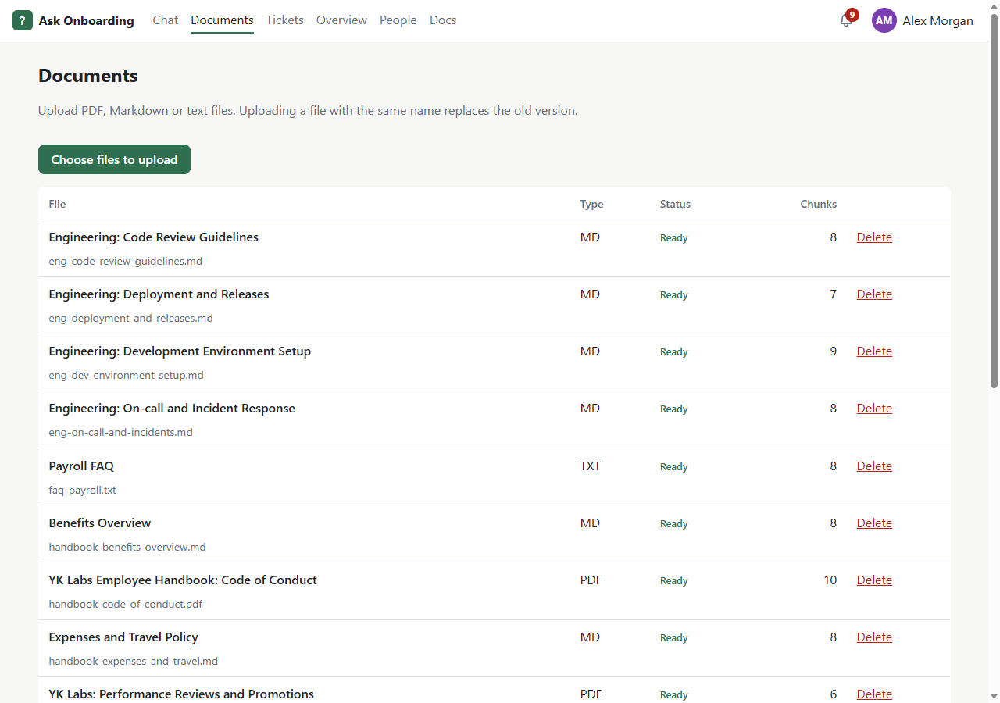
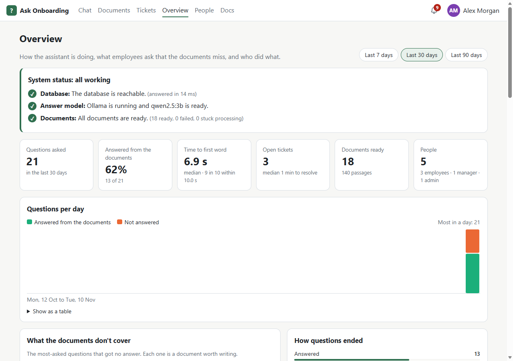
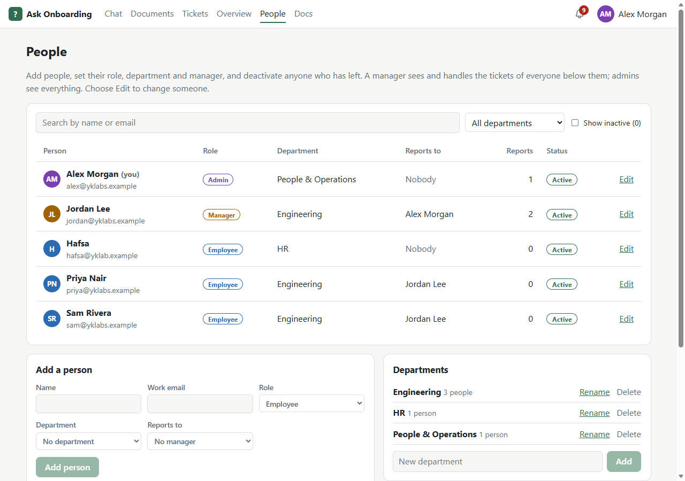

# Ask Onboarding

[](https://github.com/yunuskalam-ai/ask-onboarding/actions/workflows/ci.yml)
[](https://yunuskalam-ai.github.io/ask-onboarding/)
[](LICENSE)

Ask Onboarding is a RAG assistant that answers new employees' questions from company documents. Every answer cites the exact passage it came from. When the documents don't cover a question, the app says "I don't know" and offers to open a help-desk ticket instead.

**Stack:** FastAPI · Postgres 16 + pgvector · fastembed (local embeddings) · Ollama with qwen2.5:3b (local LLM; Claude optional) · React + Vite + TypeScript · Docker Compose

Everything runs locally. No API key is needed.

**Project page:** https://yunuskalam-ai.github.io/ask-onboarding/ (a public overview with screenshots).

**Live demo:** https://34-18-56-53.sslip.io. It's password-protected; ask the author for the login. It runs on a 4-CPU Google Cloud server without a GPU, so answers take about 10–20 s. It's set up with [deploy/README.md](deploy/README.md).

## Phase 1 and Phase 2

| | What it covers |
| --- | --- |
| **Phase 1: the take-home brief** | Upload PDF, Markdown and text; streamed answers with exact, clickable citations; an honest "not in the documents"; a help-desk ticket drafted by a model tool call and confirmed by a person; `docker compose up` as the only setup step; a 20-question evaluation; hybrid search |
| **Phase 2: refinements** | Home page; sign-in with employee, manager and admin roles enforced by the server; people management with departments and reporting lines (managers handle their team's tickets); ticket statuses, notes and history; notifications, and admin alerts that open a page with fix steps and a live check; the admin Overview (KPIs, question log, gaps in the documents, an audit log with IP, location and device); a document library for managers and admins, with delete for admins; readable document titles and a formatted source view; the Docs page; light and dark themes; a typing indicator; security hardening; CI with a 95% coverage floor; a public deployment and a project page |

[GUIDE.md](GUIDE.md) walks through every feature in plain language.

## What it looks like

| Chat with a cited answer | No answer → a drafted help-desk ticket |
| --- | --- |
|  |  |
| **Tickets** | **Documents** |
|  |  |
| **Overview (admins)** | **People (admins)** |
|  |  |

Every answer cites its sources as **[1]**, **[2]**, listed under the answer by document title. Clicking one opens the document beside the chat, formatted, with the cited passage marked and scrolled into view.

## Quick start

```bash
git clone https://github.com/yunuskalam-ai/ask-onboarding.git
cd ask-onboarding
docker compose up
```

This starts Postgres (with pgvector), Ollama, the API and the web app.

**Open http://localhost:8080.** Click **Sign in** and pick an account: there are no passwords in this demo. The 18 sample documents load automatically on the first start (watch them turn *ready* on the Documents page, about a minute). Then ask questions on the Chat page and see help-desk tickets for unanswered questions on the Tickets page. Sign in as the admin to upload your own files.

| Account | Role | Can |
| --- | --- | --- |
| Sam Rivera, Priya Nair | Employee | Ask questions, open tickets, see their own tickets |
| Jordan Lee | Manager | Also see their team's tickets (Sam and Priya report to Jordan) and browse the documents |
| Alex Morgan | Admin | Everything: all tickets, upload and delete documents, people and departments, the Overview, alerts and the project docs |

The server checks the role on every request, not just the UI.

**The first start takes a few minutes:** it downloads the Ollama image and the `qwen2.5:3b` model (about 1.9 GB). The API waits until the model is ready. Later starts take seconds.

The model runs on the CPU, so the first words of an answer take a few seconds. To use Claude instead, copy `.env.example` to `.env`, then set `LLM_PROVIDER=anthropic` and `ANTHROPIC_API_KEY`.

- API docs (try the endpoints): http://localhost:8000/docs
- The API needs a session. Sign in once and keep the cookie: `curl -c cookies.txt -H "Content-Type: application/json" -d '{"email": "alex@yklabs.example"}' localhost:8000/api/auth/sign-in`
- Upload a file (admins): `curl -b cookies.txt -F "file=@sample_docs/faq-payroll.txt" localhost:8000/api/documents`
- See document status: `curl -b cookies.txt localhost:8000/api/documents`
- Ask a question (streams Server-Sent Events): `curl -N -b cookies.txt -H "Content-Type: application/json" -d '{"question": "Can I deploy on a Friday?"}' localhost:8000/api/chat`

**Deploying to a server:** [deploy/README.md](deploy/README.md) puts the same stack on a cloud server (Google Cloud free trial or Oracle Always Free), with HTTPS and a password in front.

## Running the tests

Tests need the database running (`docker compose up -d db`). They use a separate `ask_onboarding_test` database, so your data is not touched.

```bash
# inside Docker
docker compose exec api python -m pytest

# or locally
cd backend
python -m venv .venv
.venv/Scripts/pip install -r requirements-dev.txt   # macOS/Linux: .venv/bin/pip
.venv/Scripts/python -m pytest
```

Frontend tests:

```bash
cd frontend
npm ci
npm test
```

**Everything CI checks, in one command** (lint, types, all tests with a 95% coverage floor, docs links, the production build): `bash scripts/check.sh`. What the tests cover, including every negative and security test and its result, is in [TESTING.md](TESTING.md).

## Project layout

| Path | Contents |
| --- | --- |
| `backend/app/` | FastAPI app: ingestion, retrieval, chat, tickets, sign-in and roles, notifications, admin overview (see [TECHNICAL.md](TECHNICAL.md#1-repository-layout)) |
| `backend/tests/` | pytest tests |
| `frontend/` | React app: Home, Chat, Documents, Tickets, plus Overview, People and Docs for admins |
| `eval/` | 20-question evaluation set and scoring script |
| `sample_docs/` | Sample company documents, loaded on first start |
| `scripts/` | `check.sh` (every CI check), `check_links.py` (docs links), the sample-PDF generator |
| `db/init.sql` | Enables the pgvector extension |
| `deploy/` | Public deployment: HTTPS and password (Caddy), production compose override, setup script |
| `docs/` | Screenshots and the architecture diagram |
| `site/` | The public project page, published to GitHub Pages |
| `.github/workflows/` | CI, and publishing the project page |

## Sample data

`sample_docs/` holds 18 documents for **YK Labs**, a made-up 300-person software company. There are 12 Markdown files, 4 text files and 2 multi-page PDFs, covering the employee handbook, the engineering wiki, IT guides and office information. Every name, address and email in them is fictional (`*.example` domains).

Regenerate the PDFs with `pip install fpdf2==2.8.3 && python scripts/make_sample_pdfs.py`.

## Evaluation

**Result with the defaults (hybrid search, 400-character chunks, top 5 sources, qwen2.5:3b on CPU):** 15 of 16 answerable questions answered correctly, all 4 unanswerable questions refused, and no false "I don't know" answers.

[eval/questions.json](eval/questions.json) has 20 held-out questions. None of them were used to tune anything. 16 are answerable: they cover every document type, both PDFs, and some paraphrased questions ("holiday" for "annual leave"). 4 are not in the documents (stock options, company car, dogs, sabbaticals). An answer counts as correct when it is not a refusal and contains every key fact, like "25" or "Tuesday" and "Thursday". This check is strict and gives the same score on every run. A 3B model would be an unreliable LLM judge, and the script prints every answer so the scoring can be checked by hand.

**Retrieval:** is the expected document among the top k chunks? This part is repeatable: no LLM is involved. The calibration column uses the 16 separate questions from [eval/calibrate_threshold.py](eval/calibrate_threshold.py).

| Chunk size | Search | hit@1 | hit@3 | hit@5 | Calibration hit@1 |
| --- | --- | --- | --- | --- | --- |
| **400 chars** | **hybrid** (default) | **100%** | 100% | 100% | 88% |
| 400 chars | vector | 94% | 100% | 100% | 88% |
| 800 chars | hybrid | 100% | 100% | 100% | 94% |
| 800 chars | vector | 94% | 100% | 100% | 94% |

**Answers:**

| Chunks : sources : search | Accuracy (16) | Cites the right doc | False refusals | Refusal accuracy (4) | Prompt size |
| --- | --- | --- | --- | --- | --- |
| **400 : 5 : hybrid** (default) | **94%** | 81% | 0 | **100%** | 1,975 chars |
| 400 : 5 : vector | 94% | 94% | 0 | 100% | 1,966 chars |
| 800 : 5 : vector | 88% | 81% | 0 | 100% | 3,598 chars |

What the eval changed:

- **The chunk size went from 800 to 400.** It was better on every answer metric in two separate runs, and the prompt is 45% smaller, so answers start about 3 s sooner on a CPU (7.7 s vs 10.9 s median first token). The cost: smaller chunks lose some context. On the calibration set, hit@1 drops from 15/16 to 14/16, because the "car parking" chunk no longer includes the LONDON heading. The model reads the top 5, so answers are unaffected.
- **Hybrid search became the default.** Keyword search (Postgres full-text) is merged with vector search using Reciprocal Rank Fusion. It moved the right document to rank 1 for "car parking" (3rd before) and "Which days should I be in the office?" (2nd before), which fixed the one answer every earlier run got wrong. Answer accuracy is a **tie** (94% each): each mode lost one question to the model, not to retrieval. Calibration hit@1 is also unchanged, because hybrid fixed "car parking" but ranked the security policy first for "How long must my password be?". That document also states the 14-character rule, so it is a second correct source that the question set doesn't list.
- **Paraphrased refusals are now detected.** The first run showed the model sometimes refuses in its own words ("The provided sources do not mention stock options"). Those counted as answers, so the UI offered no ticket. They are now caught, but only when the answer cites nothing.
- **Timing is measured fairly.** Ollama reuses a cached prompt start, so a config run after a similar one shows a misleadingly fast first token (1.5 s). Prompt size is reported as the repeatable speed measure.

The remaining errors come from the 3B model, not retrieval. It sometimes writes a citation where the fact should be ("SEV1 response time must be within [1]."), and it sometimes leaves out the `[n]` marker while still giving the right fact (the "Cites the right doc" column). A larger model or Claude (`LLM_PROVIDER=anthropic`) is the fix. The UI flags answers that cite nothing.

The "no answer" threshold (`MIN_SCORE=0.55`) was set separately with [eval/calibrate_threshold.py](eval/calibrate_threshold.py). Answerable questions score 0.61–0.82 and off-topic ones 0.44–0.53. Near-topic questions the documents don't answer score like answerable ones (0.61–0.66), so the prompt's refusal rule has to catch them.

Run it yourself (about 10 minutes on a laptop CPU; Git Bash on Windows needs `MSYS_NO_PATHCONV=1` in front):

```bash
docker compose exec api python /app/eval/run_eval.py                   # retrieval table + answers for 400:5 vector and hybrid
docker compose exec api python /app/eval/run_eval.py --retrieval-only  # seconds, no LLM
```

It uses a separate `ask_onboarding_eval` database and writes full results to `eval/results/`. After changing `CHUNK_SIZE` for the app itself, run `docker compose exec api python -m app.reindex`.

## Known limitations

- **Slow answers on a CPU.** The first word takes about 8–15 s with `qwen2.5:3b`, and about 30 s for the first question after Ollama restarts (the model reloads). That misses the 2-second target, which assumed a hosted model. A GPU, a hosted model, or `LLM_PROVIDER=anthropic` fixes it. See [ARCHITECTURE.md](ARCHITECTURE.md#3-scaling-to-5000-employees-200000-documents-and-20000-questions-per-day).
- **The 3B model's mistakes.** It sometimes leaves out the `[n]` citation (the UI then says "This answer did not cite a source"). Occasionally it writes "[1]" where a number should be.
- **Follow-up questions.** Earlier turns are sent to the model, but retrieval uses only the current question. So "What about Manchester?" may miss the right document.
- **Demo sign-in.** You pick an account; there are no passwords. Roles, sessions and permissions are real, but company SSO would replace the sign-in step. Every signed-in person can read every document (no per-document permissions).
- **Uploads only.** There is no Google Drive or Confluence sync. Scanned PDFs without a text layer are rejected (no OCR).
- **English only.** Both the embedding model and the full-text search are English.
- **Chat history lives in the page.** Reloading the page clears the conversation, though tickets are saved.
- **Built for one machine.** Original files are stored in Postgres, the API runs one process and opens one connection per request, and ingestion runs inside the API. [ARCHITECTURE.md](ARCHITECTURE.md) covers what changes at company scale.
- **A small evaluation set.** 20 questions, so one question moves accuracy by about 6 points.

## Docs

- [GUIDE.md](GUIDE.md): every feature in plain language, for business owners and non-technical readers
- [ARCHITECTURE.md](ARCHITECTURE.md): the brief's six questions: how a question flows through the system, the choices and what didn't work, scaling, failure modes, quality and RAG vs. fine-tuning
- [TECHNICAL.md](TECHNICAL.md): the complete technical reference: every component, table, endpoint, security control and setting
- [deploy/README.md](deploy/README.md): deploying to a server
- [TESTING.md](TESTING.md): test strategy, the negative and security tests with their results, coverage, and what isn't covered
- [AI_LOG.md](AI_LOG.md): how AI tools were used to build this
- [Project page](https://yunuskalam-ai.github.io/ask-onboarding/): a public overview with screenshots ([site/](site/))

## License

[MIT](LICENSE). YK Labs and everything in `sample_docs/` are fictional.
